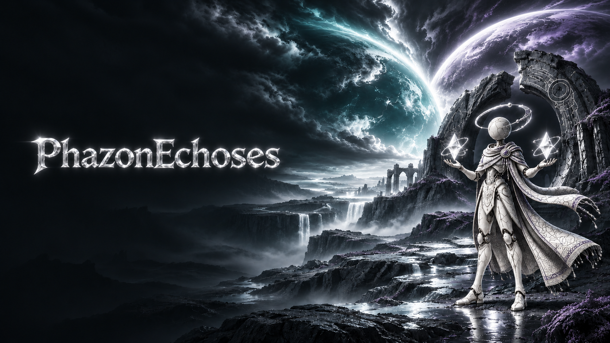

  

<h1 align="center">PhazonEchoses</h1>

  <strong>Metroid Prime 2: Echoes on PlayStation 5</strong> 
  An unofficial standalone PS5 homebrew port maintained by <a href="https://github.com/BaZZtian">BaZZtian</a>.

  

## Availability

Coming soon. The first public release is planned as `00.001.000`. Check [Releases](https://github.com/BaZZtian/PhazonEchoses/releases) for downloads and supported disc revisions.

## Installation

1. Install PhazonEchoses through Prospero Store once it is available.
2. Follow the release notes to add your own supported GameCube disc image.
3. Start PhazonEchoses from its PS5 home-screen tile.

## Support

Report a problem in [Issues](https://github.com/BaZZtian/PhazonEchoses/issues). Include your PS5 firmware, app version and disc region. Keep disc images and save files private.

## Credits

- [Odrannnn and the MetroidPrime2Port contributors](https://github.com/Odrannnn/MetroidPrime2Port) for the upstream Echoes port.
- [BaZZtian](https://github.com/BaZZtian) for the PS5 adaptation, packaging and player support.
- Retro Studios and Nintendo for the original Metroid Prime 2: Echoes.

This independent project is unaffiliated with Nintendo, Retro Studios or Sony Interactive Entertainment.
