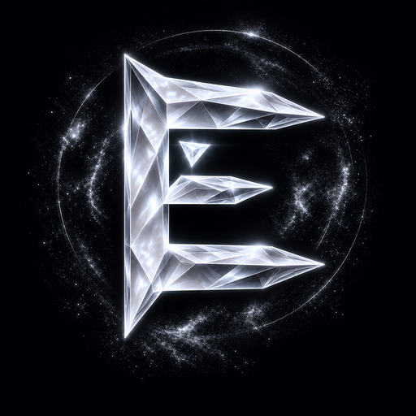

  

<h1 align="center">PhazonEchoses</h1>

  <strong>Metroid Prime 2: Echoes on PlayStation 5</strong> 
  An unofficial standalone PS5 homebrew port maintained by <a href="https://github.com/BaZZtian">BaZZtian</a>.

  

## Availability

**Coming soon.** There is no public PS5 package yet. The Prospero Store listing reserves `PPSA99737`. The planned first version is `00.001.000`. The release notes will list supported disc revisions and explain how to use your own GameCube disc image.

[GitHub releases](https://github.com/BaZZtian/PhazonEchoses/releases) · [Prospero Store catalog entry](https://github.com/darkxex/ps5-homebrew-catalog/blob/main/apps/PPSA99737.json)

## Support

Report a problem in [Issues](https://github.com/BaZZtian/PhazonEchoses/issues). Include your PS5 firmware, app version and disc region. Keep disc images and save files private.

## Credits

- [PrimeDecomp and its contributors](https://github.com/PrimeDecomp/echoes) for the Echoes decompilation.
- Odrannnn and the MetroidPrime2Port contributors for the native upstream port used as the PS5 starting point (original repository currently unavailable).
- [BaZZtian](https://github.com/BaZZtian) for the PS5 adaptation, packaging and player support.
- Retro Studios and Nintendo for the original Metroid Prime 2: Echoes.

This independent project is unaffiliated with Nintendo, Retro Studios or Sony Interactive Entertainment.
